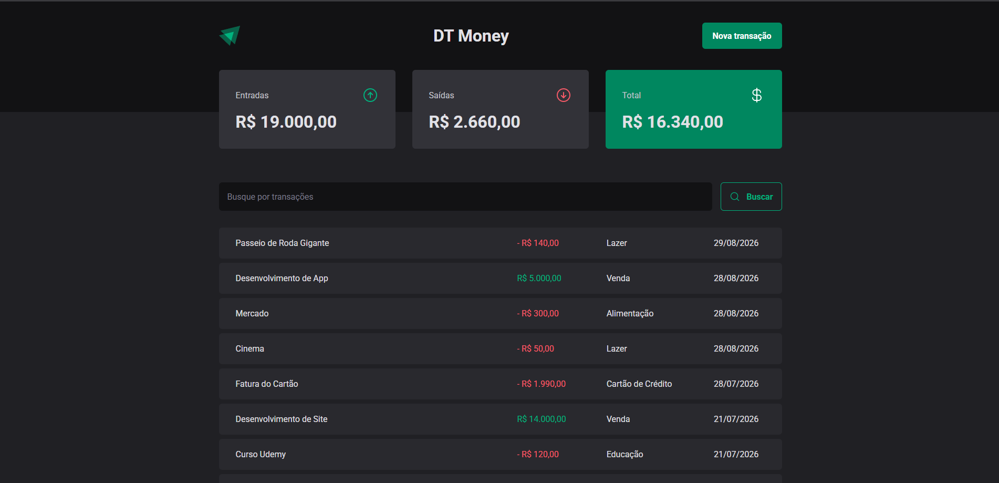

# 💰 DT Money

Take control of your finances by tracking your income, expenses, and transaction history in a simple and efficient way.



## 📌 About the Project

DT Money is a financial management application designed to help users track their income and expenses with clarity. It provides a complete overview of transactions, allowing better decision-making and financial organization.

The application focuses on simplicity, performance, and a clean user experience.

### Features

* ✅ Register new transactions (income and expenses)
* ✅ Categorize transactions
* ✅ View a complete transaction history
* ✅ Real-time balance calculation (total, income, expenses)
* ✅ Search and filter transactions
* ✅ Form validation with schema-based rules
* ✅ Performance optimizations (memoized calculations and context selectors)
* ✅ Responsive and modern interface

## 🚀 Technologies

* **React.js + TypeScript** — component-based architecture with type safety
* **Vite** — fast build tool and development environment
* **Styled Components** — styling with scoped and dynamic CSS
* **ESLint** — code standardization and quality
* **Context API** — global state management for transactions
* **useContextSelector** — selective re-renders, avoiding unnecessary component updates
* **Radix UI** — accessible and unstyled primitives for building custom UI components
* **Axios** — HTTP client for API requests, with a centralized base URL instance
* **Zod** — schema-based form validation
* **React Hook Form** — performant form state management and validation handling
* **useCallback / useMemo** — memoization to prevent unnecessary re-renders and recalculations
* **json-server** — mock REST API used as the project's "backend"

### Project Structure Highlights

* **/utils** — formatting utilities (e.g. currency and date formatters)
* **/hooks** — custom hooks encapsulating reusable logic (e.g. summary calculations)
* **/contexts** — Context API providers for global transaction state

## 💻 Running Locally

```bash
# Clone the repository
git clone https://github.com/seu-usuario/dt-money.git

# Navigate to the project folder
cd dt-money

# Install dependencies
npm install

# Start the development server
npm run dev

# Start the json-server (in a separate terminal)
npm run dev:server
```

Access at: `http://localhost:5173` and `http://localhost:3333`

## 👨‍💻 Author

**Guilherme Borges**
* LinkedIn: [linkedin.com/in/guiborgesw](https://www.linkedin.com/in/guiborgesw)